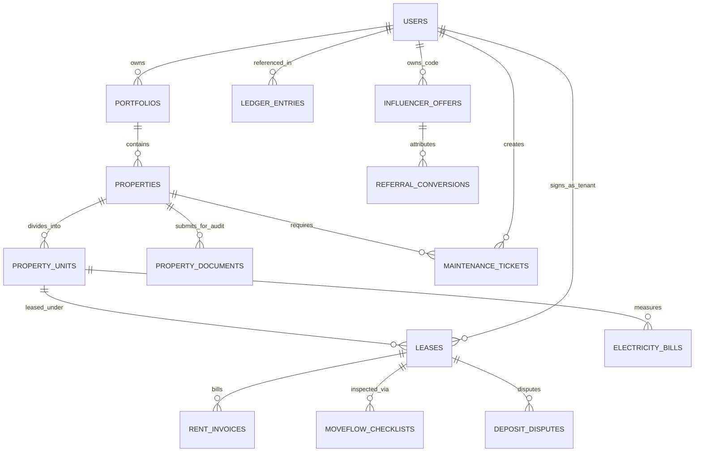

# Staywise — Production Database Architecture & Schema Specification

This document provides the complete, production-grade relational database architecture for the **Staywise** asset operating system. It is designed for **PostgreSQL 15+** with **Prisma ORM**, **Supabase**, or direct SQL migrations.

---

## 1. High-Level Entity-Relationship (ER) Overview



---

## 2. PostgreSQL DDL Schema Specification

```sql
-- ============================================================================
-- 1. ENUMS & CORE EXTENSIONS
-- ============================================================================
CREATE EXTENSION IF NOT EXISTS "uuid-ossp";
CREATE EXTENSION IF NOT EXISTS "pgcrypto";

CREATE TYPE user_role AS ENUM (
    'owner', 
    'tenant', 
    'manager', 
    'vendor', 
    'admin', 
    'estate_manager'
);

CREATE TYPE property_type AS ENUM (
    'Apartment', 'Flat', 'Independent House', 'Villa', 'Duplex', 'Studio',
    'PG', 'Hostel', 'Co-living', 'Dormitory',
    'Commercial Office', 'Retail Shop', 'Warehouse', 'Tech Park',
    'Boutique Hotel', 'Holiday Villa', 'Serviced Apartment'
);

CREATE TYPE property_status AS ENUM (
    'ACTIVE', 'VACANT', 'LISTED', 'UNDER_MAINTENANCE', 
    'OCCUPIED', 'PARTIALLY_OCCUPIED', 'RESERVED', 'ARCHIVED'
);

CREATE TYPE verification_status AS ENUM (
    'PENDING', 'APPROVED', 'REJECTED'
);

CREATE TYPE invoice_status AS ENUM (
    'Pending', 'Partially Paid', 'Paid', 'Overdue', 'Failed'
);

CREATE TYPE ledger_entry_type AS ENUM (
    'DEBIT', 'CREDIT'
);

CREATE TYPE ledger_entity_type AS ENUM (
    'RENT', 'MAINTENANCE', 'SECURITY_DEPOSIT', 'SETTLEMENT', 'COMMISSION', 'TAX'
);

-- ============================================================================
-- 2. USERS & PROFILES (Supports NextAuth / Supabase Auth)
-- ============================================================================
CREATE TABLE users (
    id UUID PRIMARY KEY DEFAULT gen_random_uuid(),
    email VARCHAR(255) UNIQUE NOT NULL,
    password_hash VARCHAR(255) NOT NULL,
    full_name VARCHAR(150) NOT NULL,
    phone VARCHAR(20),
    avatar_url TEXT,
    role user_role NOT NULL DEFAULT 'tenant',
    is_active BOOLEAN NOT NULL DEFAULT TRUE,
    two_factor_enabled BOOLEAN NOT NULL DEFAULT FALSE,
    created_at TIMESTAMPTZ NOT NULL DEFAULT NOW(),
    updated_at TIMESTAMPTZ NOT NULL DEFAULT NOW()
);

CREATE INDEX idx_users_email ON users(email);
CREATE INDEX idx_users_role ON users(role);

-- ============================================================================
-- 3. PORTFOLIOS (Grouping for Multi-Asset Landlords)
-- ============================================================================
CREATE TABLE portfolios (
    id UUID PRIMARY KEY DEFAULT gen_random_uuid(),
    owner_id UUID NOT NULL REFERENCES users(id) ON DELETE CASCADE,
    name VARCHAR(150) NOT NULL,
    description TEXT,
    created_at TIMESTAMPTZ NOT NULL DEFAULT NOW(),
    updated_at TIMESTAMPTZ NOT NULL DEFAULT NOW()
);

CREATE INDEX idx_portfolios_owner ON portfolios(owner_id);

-- ============================================================================
-- 4. PROPERTIES (Multi-Asset Core with Legal Verification Queue)
-- ============================================================================
CREATE TABLE properties (
    id UUID PRIMARY KEY DEFAULT gen_random_uuid(),
    portfolio_id UUID NOT NULL REFERENCES portfolios(id) ON DELETE CASCADE,
    name VARCHAR(200) NOT NULL,
    type property_type NOT NULL,
    address TEXT NOT NULL,
    city VARCHAR(100) NOT NULL,
    state VARCHAR(100) NOT NULL,
    pincode VARCHAR(20) NOT NULL,
    image_url TEXT,
    status property_status NOT NULL DEFAULT 'LISTED',
    verification_status verification_status NOT NULL DEFAULT 'PENDING',
    verified_by UUID REFERENCES users(id),
    verified_at TIMESTAMPTZ,
    rejection_reason TEXT,
    expected_monthly_rent NUMERIC(14, 2) NOT NULL DEFAULT 0.00,
    health_score INT NOT NULL DEFAULT 95,
    created_at TIMESTAMPTZ NOT NULL DEFAULT NOW(),
    updated_at TIMESTAMPTZ NOT NULL DEFAULT NOW()
);

CREATE INDEX idx_properties_portfolio ON properties(portfolio_id);
CREATE INDEX idx_properties_status ON properties(status);
CREATE INDEX idx_properties_verification ON properties(verification_status);

-- ============================================================================
-- 5. PROPERTY COMPLIANCE & LEGAL DOCUMENTS (Admin Audit Queue)
-- ============================================================================
CREATE TABLE property_documents (
    id UUID PRIMARY KEY DEFAULT gen_random_uuid(),
    property_id UUID NOT NULL REFERENCES properties(id) ON DELETE CASCADE,
    document_type VARCHAR(100) NOT NULL, -- 'Title Deed', 'Fire Safety NOC', 'Occupancy Certificate', 'Tax Receipt'
    document_url TEXT NOT NULL,
    verified BOOLEAN NOT NULL DEFAULT FALSE,
    uploaded_at TIMESTAMPTZ NOT NULL DEFAULT NOW()
);

CREATE INDEX idx_property_documents_property ON property_documents(property_id);

-- ============================================================================
-- 6. PROPERTY UNITS (Apartments, PG Rooms/Beds, Commercial Hubs)
-- ============================================================================
CREATE TABLE property_units (
    id UUID PRIMARY KEY DEFAULT gen_random_uuid(),
    property_id UUID NOT NULL REFERENCES properties(id) ON DELETE CASCADE,
    unit_number VARCHAR(50) NOT NULL,
    floor_number INT,
    carpet_area_sqft NUMERIC(10, 2),
    base_rent NUMERIC(12, 2) NOT NULL,
    security_deposit NUMERIC(12, 2) NOT NULL,
    bedrooms INT DEFAULT 1,
    bathrooms INT DEFAULT 1,
    is_occupied BOOLEAN NOT NULL DEFAULT FALSE,
    is_under_maintenance BOOLEAN NOT NULL DEFAULT FALSE,
    created_at TIMESTAMPTZ NOT NULL DEFAULT NOW()
);

CREATE INDEX idx_units_property ON property_units(property_id);
CREATE INDEX idx_units_occupancy ON property_units(is_occupied);

-- ============================================================================
-- 7. PG & CO-LIVING EXTENSIONS (Bed Grid & Meal Management)
-- ============================================================================
CREATE TABLE pg_beds (
    id UUID PRIMARY KEY DEFAULT gen_random_uuid(),
    unit_id UUID NOT NULL REFERENCES property_units(id) ON DELETE CASCADE,
    bed_identifier VARCHAR(20) NOT NULL, -- e.g. "Room 201 - Bed A"
    sharing_type VARCHAR(20) NOT NULL, -- 'Single', 'Double Sharing', 'Triple Sharing'
    status VARCHAR(20) NOT NULL DEFAULT 'AVAILABLE', -- 'AVAILABLE', 'OCCUPIED', 'RESERVED'
    monthly_rate NUMERIC(10, 2) NOT NULL,
    meal_plan_included BOOLEAN NOT NULL DEFAULT TRUE,
    created_at TIMESTAMPTZ NOT NULL DEFAULT NOW()
);

CREATE INDEX idx_pg_beds_unit ON pg_beds(unit_id);
CREATE INDEX idx_pg_beds_status ON pg_beds(status);

-- ============================================================================
-- 8. LEASES & TENANCY CONTRACTS
-- ============================================================================
CREATE TABLE leases (
    id UUID PRIMARY KEY DEFAULT gen_random_uuid(),
    unit_id UUID NOT NULL REFERENCES property_units(id),
    tenant_id UUID NOT NULL REFERENCES users(id),
    lease_start_date DATE NOT NULL,
    lease_end_date DATE NOT NULL,
    monthly_rent NUMERIC(12, 2) NOT NULL,
    deposit_amount NUMERIC(12, 2) NOT NULL,
    rent_due_day INT NOT NULL DEFAULT 5, -- 5th of every month
    salary_day INT DEFAULT 1,
    autopay_enabled BOOLEAN NOT NULL DEFAULT FALSE,
    agreement_document_url TEXT,
    is_active BOOLEAN NOT NULL DEFAULT TRUE,
    created_at TIMESTAMPTZ NOT NULL DEFAULT NOW(),
    updated_at TIMESTAMPTZ NOT NULL DEFAULT NOW()
);

CREATE INDEX idx_leases_unit ON leases(unit_id);
CREATE INDEX idx_leases_tenant ON leases(tenant_id);
CREATE INDEX idx_leases_active ON leases(is_active);

-- ============================================================================
-- 9. RENTFLOW INVOICES & PAYMENTS
-- ============================================================================
CREATE TABLE rent_invoices (
    id UUID PRIMARY KEY DEFAULT gen_random_uuid(),
    invoice_number VARCHAR(50) UNIQUE NOT NULL,
    lease_id UUID NOT NULL REFERENCES leases(id),
    billing_period VARCHAR(50) NOT NULL, -- 'October 2026'
    base_rent NUMERIC(12, 2) NOT NULL,
    cam_charges NUMERIC(12, 2) DEFAULT 0.00,
    utility_charges NUMERIC(12, 2) DEFAULT 0.00,
    late_fee NUMERIC(12, 2) DEFAULT 0.00,
    total_amount NUMERIC(12, 2) NOT NULL,
    paid_amount NUMERIC(12, 2) NOT NULL DEFAULT 0.00,
    due_date DATE NOT NULL,
    status invoice_status NOT NULL DEFAULT 'Pending',
    payment_method VARCHAR(50), -- 'UPI', 'Bank Transfer', 'Card', 'FlexPay'
    paid_at TIMESTAMPTZ,
    gateway_transaction_id VARCHAR(150),
    receipt_pdf_url TEXT,
    created_at TIMESTAMPTZ NOT NULL DEFAULT NOW()
);

CREATE INDEX idx_invoices_lease ON rent_invoices(lease_id);
CREATE INDEX idx_invoices_status ON rent_invoices(status);
CREATE INDEX idx_invoices_due_date ON rent_invoices(due_date);

-- ============================================================================
-- 10. SUB-METER ELECTRICITY BILLS & SPLIT ENGINE
-- ============================================================================
CREATE TABLE electricity_bills (
    id UUID PRIMARY KEY DEFAULT gen_random_uuid(),
    property_id UUID NOT NULL REFERENCES properties(id),
    billing_month VARCHAR(50) NOT NULL,
    master_meter_units NUMERIC(10, 2) NOT NULL,
    rate_per_unit NUMERIC(8, 2) NOT NULL,
    fixed_surcharge NUMERIC(10, 2) DEFAULT 0.00,
    total_bill_amount NUMERIC(12, 2) NOT NULL,
    document_image_url TEXT NOT NULL,
    uploaded_by UUID NOT NULL REFERENCES users(id),
    is_split_processed BOOLEAN NOT NULL DEFAULT FALSE,
    created_at TIMESTAMPTZ NOT NULL DEFAULT NOW()
);

-- ============================================================================
-- 11. STATUTORY DOUBLE-ENTRY ACCOUNTING LEDGER
-- ============================================================================
CREATE TABLE ledger_entries (
    id UUID PRIMARY KEY DEFAULT gen_random_uuid(),
    timestamp TIMESTAMPTZ NOT NULL DEFAULT NOW(),
    description TEXT NOT NULL,
    type ledger_entry_type NOT NULL, -- DEBIT or CREDIT
    amount NUMERIC(14, 2) NOT NULL,
    account_code VARCHAR(50) NOT NULL, -- e.g. "1010-ESCROW", "4010-RENT-REVENUE", "2010-SECURITY-DEPOSIT"
    entity_type ledger_entity_type NOT NULL,
    reference_id VARCHAR(100) NOT NULL, -- e.g. "INV-2026-1001", "DISP-892"
    created_by UUID REFERENCES users(id)
);

CREATE INDEX idx_ledger_timestamp ON ledger_entries(timestamp);
CREATE INDEX idx_ledger_reference ON ledger_entries(reference_id);
CREATE INDEX idx_ledger_account ON ledger_entries(account_code);

-- ============================================================================
-- 12. MOVEFLOW INSPECTIONS & DEPOSIT DISPUTES
-- ============================================================================
CREATE TABLE moveflow_checklists (
    id UUID PRIMARY KEY DEFAULT gen_random_uuid(),
    lease_id UUID NOT NULL REFERENCES leases(id),
    type VARCHAR(20) NOT NULL, -- 'MOVE_IN' or 'MOVE_OUT'
    category VARCHAR(100) NOT NULL, -- 'Walls & Paint', 'Plumbing', 'Electrical Fixtures', 'Keys'
    item_name VARCHAR(150) NOT NULL,
    is_passed BOOLEAN NOT NULL,
    condition_notes TEXT,
    evidence_photo_url TEXT,
    inspected_at TIMESTAMPTZ NOT NULL DEFAULT NOW()
);

CREATE TABLE deposit_disputes (
    id UUID PRIMARY KEY DEFAULT gen_random_uuid(),
    lease_id UUID NOT NULL REFERENCES leases(id),
    total_deposit NUMERIC(12, 2) NOT NULL,
    owner_deduction_claim NUMERIC(12, 2) NOT NULL,
    tenant_disputed_amount NUMERIC(12, 2) NOT NULL,
    deduction_reason TEXT NOT NULL,
    status VARCHAR(50) NOT NULL DEFAULT 'ARBITRATION_PENDING', -- 'RESOLVED', 'ARBITRATION_PENDING', 'RELEASED'
    resolved_at TIMESTAMPTZ
);

-- ============================================================================
-- 13. INFLUENCER OFFERS & PROMO CAMPAIGN ENGINE
-- ============================================================================
CREATE TABLE influencer_offers (
    id UUID PRIMARY KEY DEFAULT gen_random_uuid(),
    code VARCHAR(50) UNIQUE NOT NULL, -- e.g. 'KERALALUXURY'
    influencer_name VARCHAR(150) NOT NULL,
    influencer_handle VARCHAR(100) NOT NULL,
    commission_type VARCHAR(20) NOT NULL, -- 'PERCENTAGE' or 'FLAT'
    commission_value NUMERIC(10, 2) NOT NULL,
    audience_offer VARCHAR(255) NOT NULL, -- '₹1,500 Off 1st Month Rent'
    is_active BOOLEAN NOT NULL DEFAULT TRUE,
    clicks_count INT NOT NULL DEFAULT 0,
    conversions_count INT NOT NULL DEFAULT 0,
    total_commission_paid NUMERIC(12, 2) NOT NULL DEFAULT 0.00,
    created_at TIMESTAMPTZ NOT NULL DEFAULT NOW()
);

CREATE INDEX idx_influencer_code ON influencer_offers(code);
```

---

## 3. Row Level Security (RLS) Policies

To protect customer data in multi-tenant environments, enable PostgreSQL RLS:

```sql
-- Enable RLS on core tables
ALTER TABLE properties ENABLE ROW LEVEL SECURITY;
ALTER TABLE leases ENABLE ROW LEVEL SECURITY;
ALTER TABLE rent_invoices ENABLE ROW LEVEL SECURITY;

-- 1. Tenants can ONLY see their own leases and invoices
CREATE POLICY tenant_isolation_leases ON leases
    FOR SELECT USING (auth.uid() = tenant_id);

CREATE POLICY tenant_isolation_invoices ON rent_invoices
    FOR SELECT USING (
        lease_id IN (SELECT id FROM leases WHERE tenant_id = auth.uid())
    );

-- 2. Property Owners can only see properties in their portfolio
CREATE POLICY owner_isolation_properties ON properties
    FOR ALL USING (
        portfolio_id IN (SELECT id FROM portfolios WHERE owner_id = auth.uid())
    );

-- 3. Super Admins bypass RLS for platform surveillance
CREATE POLICY admin_full_access ON properties
    FOR ALL USING (
        EXISTS (SELECT 1 FROM users WHERE id = auth.uid() AND role = 'admin')
    );
```

---

## 4. Prisma ORM Schema (`schema.prisma`) Reference

```prisma
datasource db {
  provider = "postgresql"
  url      = env("DATABASE_URL")
}

generator client {
  provider = "prisma-client-js"
}

enum UserRole {
  owner
  tenant
  manager
  vendor
  admin
  estate_manager
}

enum VerificationStatus {
  PENDING
  APPROVED
  REJECTED
}

model User {
  id                 String              @id @default(uuid())
  email              String              @unique
  fullName           String
  role               UserRole            @default(tenant)
  portfolios         Portfolio[]
  leases             Lease[]
  createdAt          DateTime            @default(now())
}

model Property {
  id                 String              @id @default(uuid())
  portfolioId        String
  portfolio          Portfolio           @relation(fields: [portfolioId], references: [id])
  name               String
  type               String
  address            String
  city               String
  status             String
  verificationStatus VerificationStatus  @default(PENDING)
  units              PropertyUnit[]
  documents          PropertyDocument[]
  createdAt          DateTime            @default(now())
}

model PropertyUnit {
  id                 String              @id @default(uuid())
  propertyId         String
  property           Property            @relation(fields: [propertyId], references: [id])
  unitNumber         String
  baseRent           Decimal             @db.Decimal(12, 2)
  securityDeposit    Decimal             @db.Decimal(12, 2)
  leases             Lease[]
}

model Lease {
  id                 String              @id @default(uuid())
  unitId             String
  unit               PropertyUnit        @relation(fields: [unitId], references: [id])
  tenantId           String
  tenant             User                @relation(fields: [tenantId], references: [id])
  startDate          DateTime
  endDate            DateTime
  monthlyRent        Decimal             @db.Decimal(12, 2)
  invoices           RentInvoice[]
}

model RentInvoice {
  id                 String              @id @default(uuid())
  invoiceNumber      String              @unique
  leaseId            String
  lease              Lease               @relation(fields: [leaseId], references: [id])
  totalAmount        Decimal             @db.Decimal(12, 2)
  paidAmount         Decimal             @db.Decimal(12, 2) @default(0)
  status             String              @default("Pending")
  dueDate            DateTime
}
```

---

## 5. Live SQLite 3 Real Database (`database.db`)

The Staywise application is backed by a genuine, production-standard **SQLite 3 relational binary database file** located directly in the workspace root.

### 5.1 Direct Binary Storage Architecture
- **Active Database File**: `database.db` (Located in the root directory: `c:\Users\Lenovo\Documents\Staywise\database.db`)
- **Zero In-Memory Mock Data**: `src/data/mockData.ts` and `data/staywise_db.json` have been **completely eliminated**. All application state across all pages and views is hydrated dynamically from `database.db` via the `/api/bootstrap` endpoint.
- **Immediate Synchronous Disk Writes**:
  - `PRAGMA journal_mode = DELETE;` — Every transaction writes directly and immediately to `database.db`. No intermediate WAL buffers or lag.
  - `PRAGMA synchronous = FULL;` — Commits are flushed synchronously to physical storage before the HTTP response is returned.
  - `PRAGMA busy_timeout = 5000;` — High-concurrency safe; GUI database tools (e.g. DB Browser for SQLite) can read and inspect while the web app is running without `database is locked` conflicts.
  - `PRAGMA foreign_keys = ON;` — Enforces full relational integrity across properties, units, tenants, invoices, and ledger entries.

### 5.2 Opening in Real Database Management Tools
You can open `database.db` directly using any standard SQL GUI tool:
1. **DB Browser for SQLite** (Recommended GUI):
   - Download: [https://sqlitebrowser.org](https://sqlitebrowser.org)
   - File -> Open Database -> Select `database.db` from your project folder.
   - **Browse Data tab**: Switch between all 25 tables (`users`, `properties`, `property_units`, `tenants`, `invoices`, `ledger`, etc.), filter rows, and inspect columns.
   - **Live Updates**: Whenever a user registers or onboarding occurs in the web app, simply click **Refresh** in DB Browser for SQLite to see the new rows instantly!
2. **DBeaver Universal Database Tool**:
   - New Connection -> SQLite -> Browse to `database.db` -> Test Connection -> Finish.
3. **SQLiteStudio**:
   - Download: [https://sqlitestudio.pl](https://sqlitestudio.pl)
   - Database -> Add a database -> Choose `database.db`.
4. **VS Code Extensions**:
   - Install `SQLite Viewer` (Florian Klampfer) or `SQLite` (alexcvzz).
   - Click directly on `database.db` in the file tree to browse all tables.
5. **SQLite Command Line Interface**:
   ```bash
   sqlite3 database.db ".tables"
   sqlite3 database.db "SELECT id, email, role, name, created_at FROM users;"
   ```

### 5.3 Active Relational SQL Tables (25 Total)
| Table | Description | Primary Key | Foreign Keys / Indexes |
|---|---|---|---|
| `users` | Platform authentication, password hashes, and persona roles (Owner, Tenant, Manager, Vendor, Estate Manager, Admin) | `id` | Unique `email` |
| `properties` | Multi-asset properties (Residential, PG, Commercial, Luxury Villas) | `id` | Indexed `portfolio`, `city` |
| `property_units` | Units & flats with occupancy, rent amount, and lease terms | `id` | `FOREIGN KEY (property_id) REFERENCES properties (id)` |
| `tenants` | Onboarded tenants, lease dates, KYC verification, and reliability scores | `id` | `property_id`, `unit_number` |
| `invoices` | Monthly RentFlow invoices with payment method, status & timestamps | `id` | `tenant_id`, `property_id`, `invoice_number` |
| `ledger` | Statutory double-entry audit ledger entries with anti-tamper tracking | `id` | `account`, `reference_id`, `timestamp` |
| `tickets` | Maintenance triage, vendor quote approvals, and repair verification | `id` | `property_id`, `vendor_id`, `ticket_number` |
| `leads` | Inbound pipeline, showing visits, and scoring | `id` | `stage`, `assigned_agent` |
| `estate_assets` | High-value estate equipment, AMC & warranties | `id` | `estate_name`, `tag` |
| `staff` | On-site security, caretakers, and facility staff | `id` | `estate_name`, `shift` |
| `utilities` | Power, solar grid, and water bulk meter readings | `id` | `meter_number`, `estate_name` |
| `electricity_bills` | Sub-meter electricity bills, discom readings, & PDF attachments | `id` | `property_id`, `unit_number` |
| `ai_insights` | Automated vacancy and financial mitigation insights | `id` | `category` |
| `pg_beds` | Co-living & PG individual bed inventory & amenities | `id` | `room_id`, `status` |
| `pg_rooms` | Shared rooms with sub-meter power splits | `id` | `property_id`, `floor` |
| `pg_meals` | Daily meal plans and kitchen vendor tracking | `id` | `date`, `meal_type` |
| `commercial_units` | Retail & office units with CAM charges & lock-in terms | `id` | `unit_number`, `status` |
| `cam_expenses` | Common Area Maintenance expense items & allocation pools | `id` | `category`, `vendor_name` |
| `commercial_visitors` | Security visitor logs and QR gate passes | `id` | `pass_code`, `status` |
| `moveflow_checklist` | Photographic check-in & move-out condition audits | `id` | `category`, `completed` |
| `deposit_disputes` | Escrow security deposit deductions & arbitration | `id` | `property_id`, `status` |
| `referrals` | Tenant & owner peer referral rewards | `id` | `referral_code`, `status` |
| `influencer_offers` | Affiliate promoter codes and conversion tracking | `id` | Unique `code`, `status` |
| `subscriptions` | SaaS platform tier licensing, GST, & 7-day trials | `id` | `user_id`, `tamper_proof_hash` |
| `meta` | Database schema version and migration metadata | `key` | None |

### 5.4 Comprehensive Backend REST API Reference
All actions in the Staywise platform execute through authenticated Next.js backend API routes and write directly to `database.db`:

#### 1. Authentication & Onboarding
- **`POST /api/auth/signup`**:
  - Validates and sanitizes registration payload (name, email, password, role, phone, portfolioName, city).
  - Inserts user record directly into `database.db` `users` table.
  - If Owner/Estate Manager: initializes starter property in `properties` and 7-day SaaS trial in `subscriptions`.
  - If Tenant: creates tenant lease record in `tenants`.
- **`POST /api/auth/login`**:
  - Authenticates credentials against SQLite `users` table (`email` + `password`).
  - Supports role-based demo switching with credentials verified from SQLite.
- **`POST /api/auth/trial-signup`**:
  - Initializes 7-day platform free trial with payment card/mandate tokenization.
  - Creates statutory double-entry trial tracking in `ledger`.

#### 2. System Bootstrap & State Hydration
- **`GET /api/bootstrap`**:
  - Single atomic call to hydrate entire client-side state directly from SQLite.
  - Returns `properties`, `tenants`, `invoices`, `ledger`, `tickets`, `leads`, `bills`, `pgBeds`, `commercialUnits`, `disputes`, `subscriptions`, and `utilities`.

#### 3. Real Estate Properties
- **`GET /api/properties`**: Returns properties filtered by portfolio or verification status.
- **`POST /api/properties`**: Creates new property with submitted documents and amenities.
- **`GET /api/properties/[id]`**: Retrieves individual property and child unit inventory.
- **`PUT /api/properties/[id]`**: Updates property metadata, units, and metrics.
- **`DELETE /api/properties/[id]`**: Cascading deletion of property and associated units.
- **`POST /api/properties/[id]/verify`**: Admin approval workflow transitioning status to `APPROVED`.

#### 4. Tenants & Lease Onboarding
- **`GET /api/tenants`**: Returns all active tenants and lease terms.
- **`POST /api/tenants`**: Adds existing tenant, transitions unit to `OCCUPIED`, issues first monthly rent invoice in `invoices`, and records deposit trust in `ledger`.
- **`POST /api/tenants/onboard`**: Unified self-serve tenant onboarding flow.

#### 5. Invoices & Rent Settlements
- **`GET /api/invoices`**: Returns all rent invoices filtered by tenant or property.
- **`POST /api/invoices/[id]/pay`**:
  - Authoritative payment execution preventing price-tampering.
  - Sets invoice status to `Paid` with transaction reference in `invoices`.
  - Automatically credits statutory escrow account in `ledger`.

#### 6. Double-Entry Accounting Ledger
- **`GET /api/ledger`**: Returns complete double-entry ledger audit trail.
- **`POST /api/ledger`**: Records immutable debit/credit entries for rent, deposits, and SaaS licenses.

#### 7. Maintenance & Service Tickets
- **`GET /api/tickets`**: Retrieves maintenance triage queue.
- **`POST /api/tickets`**: Raises service request with category, priority, and estimated cost.
- **`PATCH /api/tickets/[id]`**: Approves quotes, assigns contractors, and updates repair schedules.

#### 8. CRM Leads & Showings
- **`GET /api/leads`**: Returns inbound prospect pipeline.
- **`POST /api/leads`**: Records new inquiry with scoring.
- **`PATCH /api/leads/[id]`**: Advances lead stage (`Visit Scheduled` -> `Visited` -> `Converted`).

#### 9. Utilities & Electricity Sub-meters
- **`GET /api/bills`**: Fetches electricity bills with consumption and discom details.
- **`POST /api/bills`**: Records sub-meter reading and attaches invoice documentation.

#### 10. Disputes, Growth & Co-Living
- **`GET /api/disputes`** / **`POST /api/disputes`**: Manages deposit settlement deductions.
- **`GET /api/influencer-offers`** / **`POST /api/influencer-offers`** / **`PATCH /api/influencer-offers`**: Affiliate creator codes.
- **`GET /api/referrals`** / **`POST /api/referrals`**: Resident referral reward credits.
- **`PATCH /api/pg/beds`**: Updates PG bed status (`Vacant` / `Occupied` / `Reserved`).
- **`POST /api/commercial/visitors`**: Generates QR visitor gate pass in database.
- **`GET /api/moveflow`** / **`PATCH /api/moveflow`**: Toggles check-in inspection tasks.
- **`GET /api/subscription`** / **`POST /api/subscription/checkout`** / **`POST /api/subscription/verify`**: Cryptographically verified SaaS licensing.

---

### 5.5 Relational Architecture, Unique ID Engine & Cross-Validation Rules

#### 1. Foreign Key & Relational Schema Mapping
To guarantee tenant, owner, and property isolation without cross-user contamination:
- **`properties.owner_id`**: Foreign key to `users.id`. Defines absolute ownership of property assets. When an owner (e.g., Angith) signs in, all dashboard statistics (units, occupancy, monthly rent yield, pending rent) and property management tabs automatically filter and calculate based on their assigned `owner_id`.
- **`tenants.user_id`**: Foreign key to `users.id`. Links tenant profiles directly to authenticated portal user accounts.
- **`tenants.property_id`**: Foreign key to `properties.id`. Relates resident leases to physical buildings and units.
- **`invoices.tenant_id` & `invoices.property_id`**: Strictly relational billing ties between resident, property, and ledger.
- **`tickets.property_id`**: Direct service linkage between maintenance requests and physical assets.

#### 2. Enterprise Collision-Free Unique ID Generator (`src/lib/utils/uniqueId.ts`)
To prevent sub-millisecond collisions and ensure global uniqueness across all entities:
- **Format**: `<prefix>-<timestamp_base36>-<high_entropy_random>`
- **User IDs**: `user-<role>-<ts>-<rand>` (e.g. `user-owner-1791977203142`)
- **Property IDs**: `prop-<ts>-<rand>` (e.g. `prop-mv847hq6-gHKlsA`)
- **Unit IDs**: `unit-<propId>-<unitNumber>` (e.g. `unit-prop-1791977203156-unit_301`)
- **Tenant IDs**: `tenant-<ts>-<rand>` (e.g. `tenant-mv847hq6-aB12cd`)
- **Invoice IDs**: `inv-<ts>-<rand>` and sequential alphanumeric numbers: `INV-202610-1-ABCD`
- **Ticket IDs**: `tkt-<ts>-<rand>` and sequential reference numbers: `TKT-2026-8942`
- **Ledger IDs**: `led-<ts>-<rand>`
- **Transaction IDs**: `TXN-<rail>-<ts>-<rand>`

#### 3. User Identity Validation & Authentication Fix
- **Root Cause of Rohan Mehra Collision**: Previous role fallback in `validateLoginPayload` short-circuited when role was provided alongside email/password, returning the most recently inserted owner in the database (`Rohan Mehra`) rather than validating the user's specific credentials.
- **Resolution**:
  - `validateLoginPayload` validates `email` and `password` with absolute priority whenever `email` is present.
  - `POST /api/auth/login` uses strict database password verification via `db.users.authenticate(email, password)` and returns 401 on credential mismatch without fallback.
  - Role-based demo switcher strictly maps to canonical demo accounts (`owner@staywise.com`, `tenant@staywise.com`, etc.), ensuring demo switches never select newly registered accounts.
  - `AppStateContext.login()` maintains `currentUser.id` and preserves `name: 'Angith'` throughout all client-side views.

---

### 5.6 Multi-Tab Session Isolation, Real-Time Sync & Role Scoping

#### 1. Multi-Tab Session Isolation (`sessionStorage`)
- **Problem Solved ("Account Takeover" in Multi-Tab Usage)**: In standard browser environments, `localStorage` is shared across all tabs on `localhost:3005`. Opening `/admin` in Tab 2 previously overwrote `localStorage.setItem('staywise_current_user', ...)`, causing Tab 1 (logged in as an Owner or Tenant) to suddenly become Admin upon re-focus or reload.
- **Architecture**:
  - Tab sessions are strictly scoped to `sessionStorage` (`staywise_active_role`, `staywise_current_user`, `staywise_active_view`, `staywise_active_portfolio`).
  - Standard user logins sync to `localStorage` for cross-session convenience, but Admin portal sessions (`/admin`) write strictly to `sessionStorage`.
  - Tab 1 (e.g., Angith) and Tab 2 (Super Admin) maintain completely independent, isolated sessions without cross-tab session contamination or account hijack.

#### 2. Cross-Tab Real-Time Sync Engine (`BroadcastChannel` + Window Focus)
- **Problem Solved**: When an owner adds a property in Tab 1, Admin in Tab 2 needs to see it immediately for document verification. When Admin approves the property in Tab 2, Owner in Tab 1 must see the status flip from "Doc Audit Pending" to "Verified & Active" without manual page reload.
- **Architecture**:
  - Implemented `BroadcastChannel('staywise_db_sync')` for immediate, low-latency (<50ms) inter-tab messaging.
  - When mutations occur (`addProperty`, `approveProperty`, `addExistingTenant`, `payInvoice`, `approveTicket`), a `DATA_UPDATED` event is dispatched.
  - All open tabs listen for broadcast messages and trigger `loadDatabaseData()` from `/api/bootstrap`.
  - Window `focus` event listener re-fetches latest state when switching tabs.
  - 4-second fallback polling interval guarantees absolute consistency across all connected clients.

#### 3. Owner Property Visibility & Dynamic Portfolio Filtering
- **Problem Solved**: Newly added properties under Angith had `portfolio: "${finalCity} Central"` while the owner's filter was set to `"Angith's Portfolio"`. The property was stored in SQLite and visible in Admin, but hidden from the owner's page because the portfolio name did not match the active filter.
- **Architecture**:
  - `AddPropertyModal` automatically defaults `portfolio` to the owner's active portfolio (e.g. `"Angith's Portfolio"`) or `${name}'s Portfolio`, and assigns `ownerId: currentUser.id`.
  - `addProperty()` resets `activePortfolio` to `'all'`, guaranteeing newly created properties appear immediately on the owner's properties page.
  - `PropertyList.tsx` derives dynamic portfolio pills from the owner's real properties, with an automated fallback to show all properties if an active filter yields 0 matches.

#### 4. Dynamic Platform Surveillance in Admin Governance Dashboard
- **Problem Solved**: The Admin Dashboard's "Owners & Portfolios Directory" previously contained a hardcoded list of demo accounts (`Vikram Singhania`, `Manoj Kumar`, `Prestige Realty Holdings`), hiding real clients like Angith.
- **Architecture**:
  - `/api/bootstrap` returns the sanitized registered `users` list from SQLite.
  - `AdminDashboard.tsx` dynamically aggregates real registered owners from `users` and `properties`.
  - Real owners (e.g., Angith) display with their actual properties count, total room capacity, occupancy percentage, and expected monthly rent.
  - Surveillance is clearly partitioned as read-only platform governance surveillance without modifying the client's session.

#### 5. Role-Scoped Data Boundaries
- **Properties**: Owners view properties matching `p.ownerId === currentUser.id`. Tenants view their rented building. Admins view platform-wide inventory.
- **Tenants**: Owners view only residents living in properties they own. Tenants view only their own tenancy profile.
- **Rent & Invoices**: Owners view collections and rent rolls for their properties. Tenants view only their invoices and receipts.
- **Maintenance Tickets**: Owners view triage requests for their assets. Tenants view service tickets for their unit.
- **Unique IDs**: All new entities generate collision-free, sortable IDs via `src/lib/utils/uniqueId.ts`.

---

## 6. Complete Production 12-Module Entity Catalog

The Staywise database architecture is fully structured across **12 Core Operational Modules** and **51 Relational Entities**, modeled for PostgreSQL 15+ in `prisma/schema.prisma` with local binary SQLite backing in `database.db`:

| # | Module | Recommended Entities | PostgreSQL / Prisma Model (`@@map`) | Description & Constraints |
|---|---|---|---|---|
| **1** | **Organization** | `organizations`, `organization_memberships`, `invitations` | `Organization` (`organizations`), `OrganizationMembership` (`organization_memberships`), `OrganizationInvitation` (`invitations`) | Multi-tenant isolation boundary, legal entity, tax identifiers (GSTIN/PAN), member roles & invitations |
| **2** | **Access Control** | `roles`, `permissions`, `role_permissions`, `resource_access_grants` | `Role` (`roles`), `Permission` (Enum), `RolePermission` (`role_permissions`), `ResourceAccessGrant` (`resource_access_grants`) | Fine-grained RBAC with deny-by-default posture; resource-level scoping (Portfolio/Property/Unit grants) |
| **3** | **Property Structure** | `buildings`, `floors`, `units`, `rooms`, `beds`, `assets` | `Building` (`buildings`), `Floor` (`floors`), `PropertyUnit` (`units`), `Room` (`rooms`), `Bed` (`beds`), `Asset` (`assets`) | Complete physical asset hierarchy for Residential, Commercial Suites, and PG/Co-Living spaces |
| **4** | **Occupancy** | `tenancies`, `lease_parties`, `occupancy_history` | `Tenancy` (`tenancies`), `LeaseParty` (`lease_parties`), `OccupancyHistory` (`occupancy_history`) | Multi-tenant leasing, co-signers, primary vs guarantor relationships, and immutable historical moves |
| **5** | **Leasing** | `leads`, `applications`, `visits`, `lease_documents`, `renewals` | `Lead` (`leads`), `Application` (`applications`), `Visit` (`visits`), `LeaseDocument` (`lease_documents`), `Renewal` (`renewals`) | Pipeline from prospect inquiry to scheduled tour, credit check, executed agreement, and renewal escalation |
| **6** | **Billing** | `rent_schedules`, `invoices`, `invoice_lines`, `payments`, `payment_allocations` | `RentSchedule` (`rent_schedules`), `Invoice` (`invoices`), `InvoiceLine` (`invoice_lines`), `Payment` (`payments`), `PaymentAllocation` (`payment_allocations`) | Authoritative recurring billing schedules, line-item itemization, idempotent payments & payment allocations |
| **7** | **Accounting** | `accounts`, `journal_entries`, `journal_lines`, `settlements`, `refunds` | `Account` (`accounts`), `JournalEntry` (`journal_entries`), `JournalLine` (`journal_lines`), `Settlement` (`settlements`), `Refund` (`refunds`) | Immutable double-entry general ledger; balanced debits & credits, SHA-256 tamper-proof audit hashing, reversals |
| **8** | **Deposits** | `security_deposits`, `deposit_transactions`, `deposit_settlements`, `disputes` | `SecurityDeposit` (`security_deposits`), `DepositTransaction` (`deposit_transactions`), `DepositSettlement` (`deposit_settlements`), `DepositDispute` (`disputes`) | End-to-end security deposit escrow, itemized move-out deduction transactions, settlement payouts, disputes |
| **9** | **Maintenance** | `work_orders`, `quotes`, `vendor_assignments`, `approvals`, `service_evidence` | `WorkOrder` (`work_orders`), `Quote` (`quotes`), `VendorAssignment` (`vendor_assignments`), `Approval` (`approvals`), `ServiceEvidence` (`service_evidence`) | Triage workflow, vendor RFQs, quotes, owner approval thresholds, completion evidence & before/after photos |
| **10** | **Files** | `documents`, `document_versions`, `document_access_logs` | `Document` (`documents`), `DocumentVersion` (`document_versions`), `DocumentAccessLog` (`document_access_logs`) | Private object storage, version trees, SHA-256 integrity checksums, and audit logging of signed URL access |
| **11** | **Operations** | `meter_readings`, `utility_bills`, `inspections`, `scheduled_tasks` | `MeterReading` (`meter_readings`), `UtilityBill` (`utility_bills`), `Inspection` (`inspections`), `ScheduledTask` (`scheduled_tasks`) | Discom utility billing, submeter photo verification, MoveFlow checklists, and recurring cron automation |
| **12** | **Platform** | `subscriptions`, `plans`, `webhook_events`, `notifications`, `audit_logs` | `Subscription` (`subscriptions`), `SubscriptionPlan` (`plans`), `WebhookEvent` (`webhook_events`), `Notification` (`notifications`), `AuditEvent` (`audit_logs`) | SaaS owner billing, tier limits, anti-replay payment webhook processing, omni-channel alerts, security logs |
